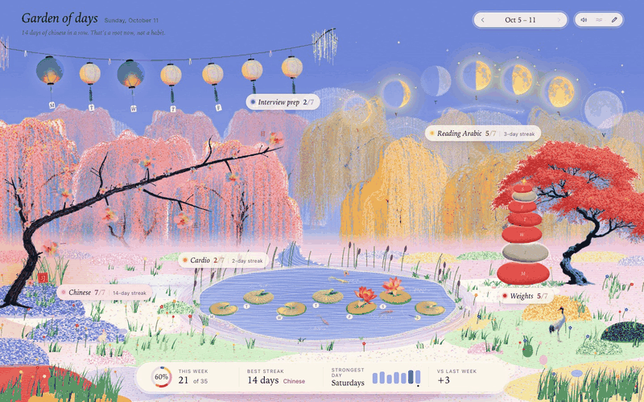
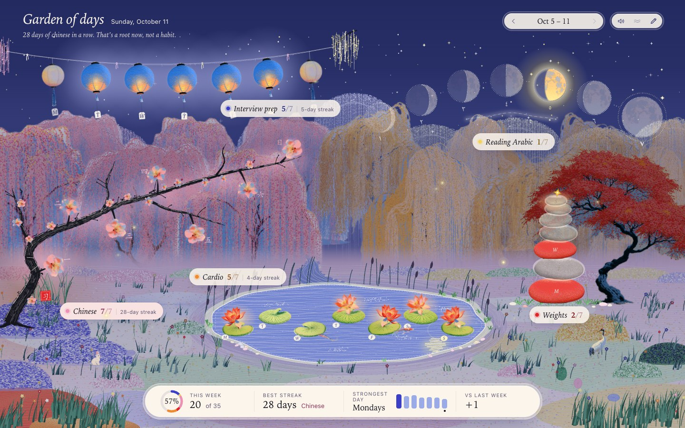

# Garden of Days

A habit tracker for Mac that looks like a painting instead of a spreadsheet. Each habit is an object in a garden, and the garden fills in as the week goes on.



## How it works

There are five habits and each one has seven spots, Monday to Sunday. Click a spot to mark the day done.

| Habit | In the garden | When you do it |
|---|---|---|
| Interview prep | Paper lanterns on a string | A lantern lights up |
| Reading Arabic | An arc of moons | The moon fills in |
| Chinese | An ink plum branch | A bud opens |
| Weights | A stone cairn under the maple | A stone gets stacked |
| Cardio | Lily pads on the koi pond | A lotus blooms |

The habits are mine, but you can rename them with the pencil button.

A few things I cared about while making it:

- Days you skip are called "resting", not "missed". Nothing wilts or breaks. A lost streak shouldn't feel like a punishment.
- The sky follows your clock, so the garden has a dawn, day, dusk and night.
- Everything that sways is moved by the same wind, so a gust rolls across the whole scene from left to right.
- Each habit plays its own note when you click it, going up through the week.
- The bar at the bottom shows the week so far, your best streak and your strongest day.



## Run it

In a browser, with no install:

```bash
cd web
python3 -m http.server 8787
```

Then open http://127.0.0.1:8787/index.html?demo. The `?demo` part fills the garden with random data and saves nothing. Leave it off to track for real (the browser version saves to localStorage).

Other URL options for looking around:

- `?phase=night` (or `dawn`, `dusk`, `day`) forces the time of day
- `?now=2026-10-11T21:30` fakes the clock

As a Mac app (macOS 13 or later, with the Xcode command line tools):

```bash
./build.sh
```

This compiles the app, copies it to `~/Applications` and puts a shortcut on your Desktop. The Mac app saves to `~/Library/Application Support/Garden of Days/data.json` and keeps a daily backup for the last 30 days.

## How it's built

- `web/` is the whole garden. It's plain JavaScript, SVG and one canvas, with no framework and no dependencies.
- `web/js/core/` has the shared parts (state, wind, sound, particles, the header and stats bar).
- `web/js/regions/` has one file per habit. Each file draws its own object and handles its own seven days.
- `web/js/scene/` has the background, the grass and the animals.
- `mac/main.swift` is a small Swift window that hosts the web garden and saves the data to disk.
- `tools/` has the scripts I used to cut the painted artwork out of its background.

The trees, lanterns, moons, stones and animals are painted sprites I generated with Midjourney and then cleaned up. The original full-size renders aren't in this repo because they're about 190 MB.

## Status

Still being worked on. The number of habits is fixed at five for now.
